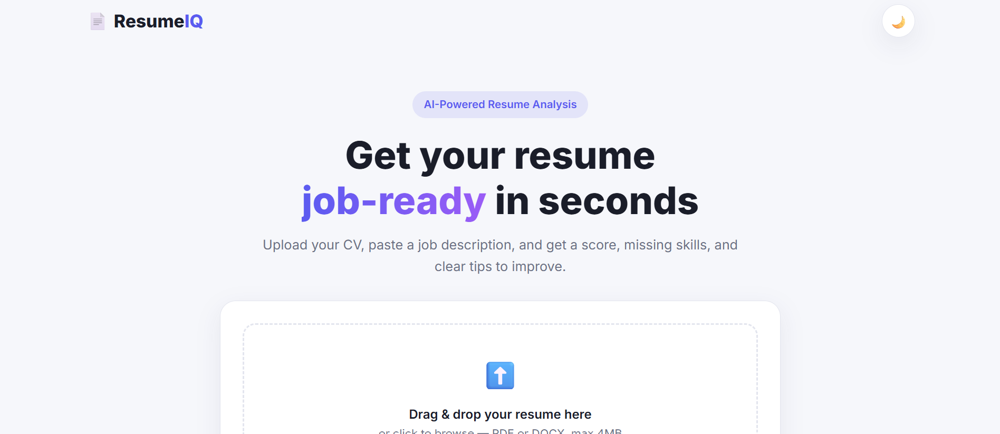
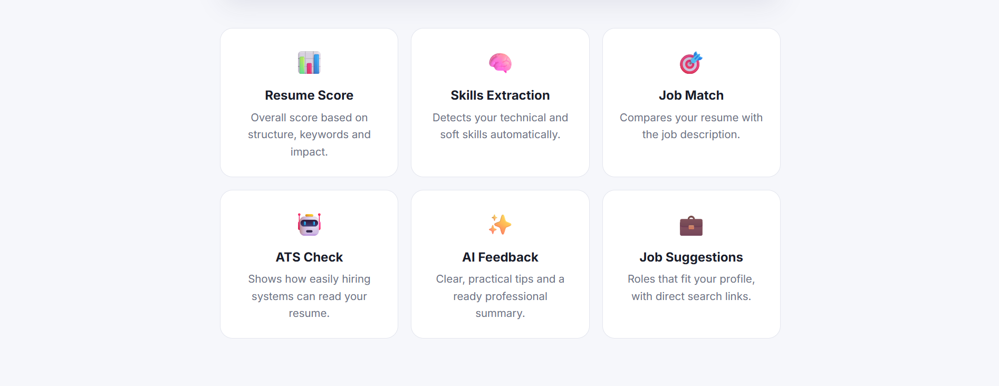
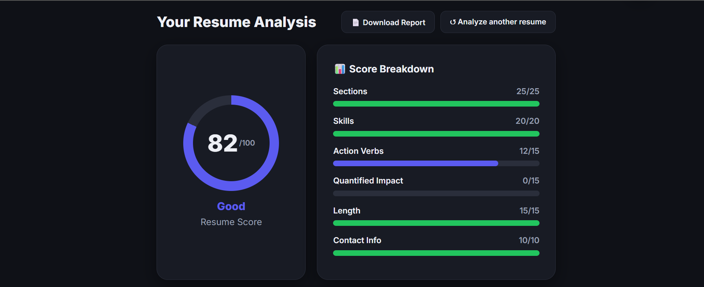
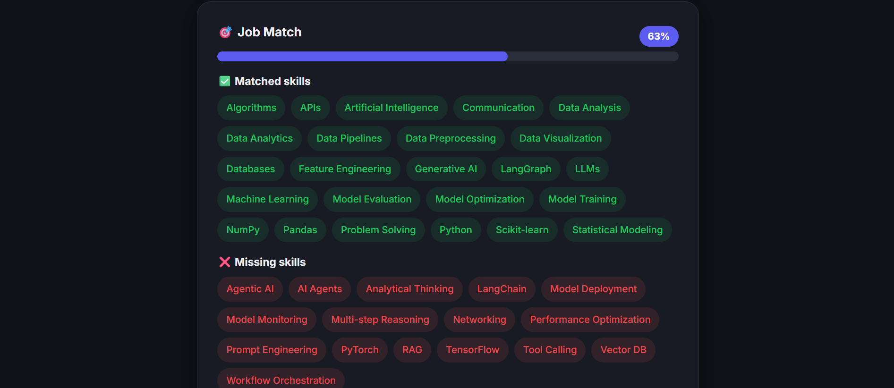
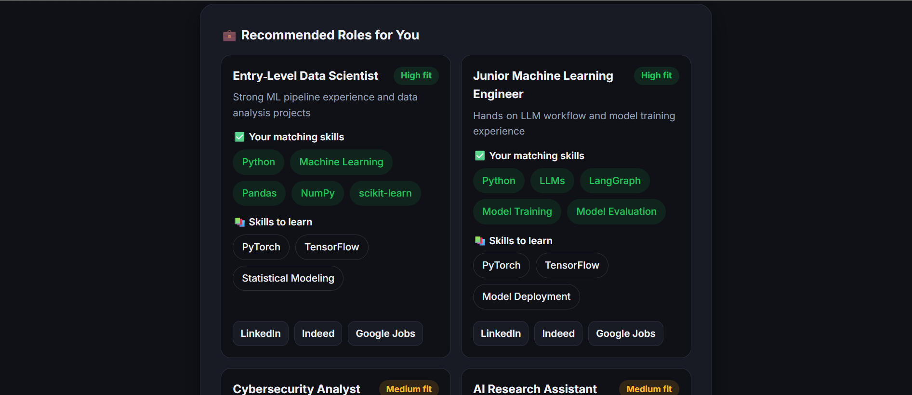
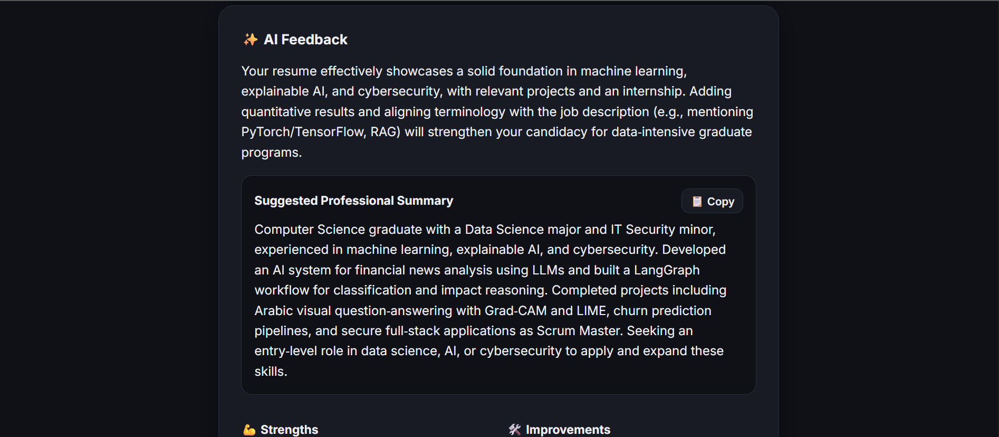
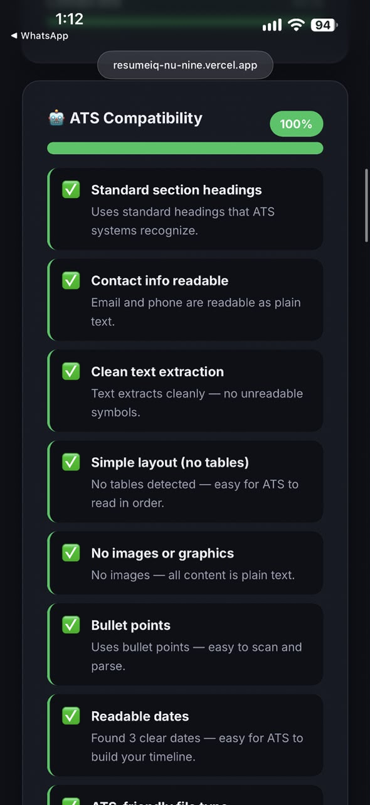

# 📄 ResumeIQ – AI Resume Analyzer

An AI-powered web app that analyzes resumes for **any profession** — tech, business, education, healthcare and more. Upload a PDF or DOCX resume, optionally paste a job description, and get a score, extracted skills, job match, ATS check, AI feedback and job suggestions in seconds.

🔗 **Live demo:** [resumeiq-nu-nine.vercel.app](https://resumeiq-nu-nine.vercel.app)

> Built as part of the **Sqrock IT Solutions** internship — Phase 2, Task 2.

---

## 📸 Screenshots

### Homepage



### Results
| Dashboard (dark mode) | Job Match |
|---|---|
|  |  |

| Recommended Roles | AI Feedback |
|---|---|
|  |  |

### Mobile


---

## ✨ Features

### Core features
- **Resume upload** — PDF or DOCX (drag & drop, up to 4MB)
- **Resume score (0–100)** — based on sections, skills, action verbs, quantified impact, length and contact info
- **Skills extraction** — detects technical and soft skills and groups them by category
- **Job description matching** — match score, matched skills and missing skills
- **Missing keyword suggestions** — important ATS keywords from the job description that the resume lacks
- **AI-powered feedback** — strengths, specific improvements and an honest overall review
- **Responsive dashboard** — works on desktop and mobile

### Bonus features
- 🤖 **ATS compatibility score** — checks headings, contact info, icon fonts, tables, images, bullet points and dates
- ✨ **AI-generated professional summary** — ready to copy into your resume
- 📄 **Download analysis report as PDF**
- 🌙 **Dark mode** — remembers your choice

### Extra
- 💼 **Recommended roles** — job titles that fit the resume, with skills to learn and direct search links (LinkedIn, Indeed, Google Jobs). If the resume is a weak match for the pasted job, these roles move to the top.

---

## 🧠 How It Works

```
Resume (PDF/DOCX)
      │
      ▼
 1. Parse ─────────► text, contact info, sections, layout (pdfplumber / python-docx)
      │
      ▼
 2. Skills ────────► Layer 1: skills dictionary (whole-word matching)
      │              Layer 2: the resume's own Skills section (any profession)
      │              Layer 3: AI-detected skills
      ▼
 3. Score ─────────► rule-based score out of 100 + quick tips
      │
      ▼
 4. AI feedback ───► summary, strengths, improvements, job skills, suggested roles (Groq)
      │
      ▼
 5. Job match ─────► 70% skill coverage + 30% TF-IDF text similarity
      │
      ▼
 6. ATS check ─────► ATS compatibility score
      │
      ▼
   Dashboard
```

The app works **even without the AI** — if the AI is unavailable, it falls back to the rule-based analysis and shows a notice.

### Resume score breakdown

| Criterion | Points |
|---|---|
| Sections (Summary, Education, Experience/Projects, Skills) | 25 |
| Skills | 20 |
| Action verbs | 15 |
| Quantified impact (%, numbers) | 15 |
| Length (350–900 words) | 15 |
| Contact info (email, phone, LinkedIn/GitHub) | 10 |
| **Total** | **100** |

---

## 🛠️ Tech Stack

| Layer | Technology |
|---|---|
| Backend | Python, Flask |
| Resume parsing | pdfplumber, python-docx |
| NLP | Custom pipeline: tokenization, stop words, regex skill matching, TF-IDF + cosine similarity |
| AI | Groq API (`openai/gpt-oss-120b`) |
| Frontend | HTML, CSS, JavaScript (no frameworks) |
| Deployment | Vercel |

> The NLP is written in pure Python (no heavy libraries) so the app stays lightweight and fits serverless deployment.

---

## 📁 Project Structure

```
resume-analyzer/
├── app.py                  # Flask app and routes
├── analyzer/
│   ├── parser.py           # PDF/DOCX text, contact info, sections, layout
│   ├── skills.py           # 3-layer skills extraction
│   ├── textutils.py        # tokenization, stop words, TF-IDF similarity
│   ├── scorer.py           # resume score and tips
│   ├── matcher.py          # job description matching
│   ├── ai_feedback.py      # Groq AI feedback
│   └── ats.py              # ATS compatibility check
├── data/
│   └── skills.json         # skills dictionary, aliases, related skills
├── templates/
│   └── index.html
├── static/
│   ├── css/style.css
│   └── js/main.js
├── requirements.txt
└── vercel.json
```

---

## 🚀 Run Locally

**1. Clone the repo**
```bash
git clone https://github.com/meroaymann/ai-resume-analyzer.git
cd ai-resume-analyzer
```

**2. Create a virtual environment and install requirements**
```bash
python -m venv venv
venv\Scripts\activate        # Windows
# source venv/bin/activate   # macOS / Linux
pip install -r requirements.txt
```

**3. Add your Groq API key** — create a `.env` file in the project root:
```
GROQ_API_KEY=your_groq_api_key
GROQ_MODEL=openai/gpt-oss-120b
FLASK_DEBUG=1
```
You can get a free key from [console.groq.com](https://console.groq.com). Without a key, the app still runs using rule-based analysis only.

**4. Run the app**
```bash
python app.py
```
Open **http://127.0.0.1:5000**

---

## ☁️ Deployment (Vercel)

1. Push the project to GitHub
2. Import the repository on [Vercel](https://vercel.com) (Framework Preset: **Other**)
3. Add the environment variables `GROQ_API_KEY` and `GROQ_MODEL`
4. Deploy — `vercel.json` handles the Flask setup

---

## 🔐 Privacy

- Uploaded resumes are **deleted immediately** after their text is read — nothing is stored on the server.
- The resume text is sent to the Groq API to generate the AI feedback.
- The API key is kept in environment variables and is never pushed to GitHub.

---

## ⚠️ Known Limitations

- Designed for **English** resumes.
- Scanned (image-only) PDFs can't be read — the app asks for a text-based file.
- Text inside Word text boxes or complex two-column layouts may be read out of order (the ATS check warns about these layouts).
- AI results can vary slightly between runs.

---

## 👩‍💻 Author

**Amira Ayman**
- GitHub: [@meroaymann](https://github.com/meroaymann)
- LinkedIn: [Amira Ayman](https://www.linkedin.com/in/amira-ayman-72580231b)

Built during the **Sqrock IT Solutions** internship program.